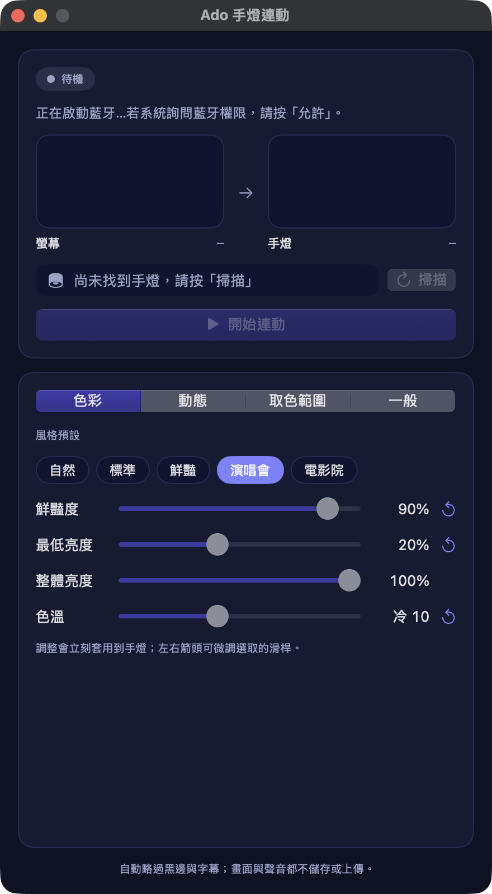

# Ado Light Stick Screen Sync

English ｜ [中文](README.md)

Samples the average color of your main screen (skipping letterbox bars and subtitles) and drives your own Ado Light Stick over Bluetooth Low Energy, so the penlight follows the video you are watching. Includes desktop apps for macOS and Windows plus a macOS command-line tool. No network, phone, or official app is needed to sync (only the update check contacts GitHub, and it can be turned off).

## Download

Get the latest build from [Releases](https://github.com/Gcree/penlight-sync/releases):

- `PenlightSync-macOS.zip`: macOS 14 or later (Apple silicon and Intel).
- `PenlightSync-Windows-x64.zip`: Windows 10 (version 2004) or 11. The .NET runtime is bundled; nothing else to install.

## Desktop apps

Both apps share the same layout, and the colors follow the system light/dark setting (the dark set uses the icon's indigo palette):



- **Live card** at the top: a status pill (idle / connecting / syncing…), latency, and two swatches, "screen average color → current lamp color" (the lamp swatch only updates after the lamp acknowledges a write). Below them: the lamp picker, 掃描 (Scan), and 開始連動／停止連動 (Start/Stop). The last selected lamp is remembered.
- **Settings tabs** below: 色彩 (Color), 動態 (Motion), 取色範圍 (Capture area), and 一般 (General). Each slider shows its value, and an adjusted slider gets a "↺" button to restore its default. The General tab holds the update check, the log (expandable), and 全部重設 (Reset all: color and motion settings return to defaults; the lamp and capture area stay).
- **Style presets** (Color tab): one click sets vibrance, minimum brightness, overall brightness, and color temperature together: 自然 (Natural), 標準 (Standard, the defaults), 鮮豔 (Vivid), 演唱會 (Concert), 電影院 (Cinema). You can still fine-tune afterwards.
- **Capture area**: the whole main screen by default. Click 框選範圍… (Select area) and drag around the video (Esc cancels) so the lamp follows only that part of the screen, which helps when the video is not full screen. Click 整個螢幕 (Whole screen) to go back. The choice is remembered and can be changed while syncing.
- **Auto-reconnect**: if the lamp drops the connection or a Bluetooth write fails while syncing, the app keeps the current light state and reconnects on its own for up to 30 seconds; it only stops (with the reason) if that fails. If it keeps failing, hold the lamp's back button to put it in pairing mode.
- **Latency readout**: while syncing, a line under the status shows recent average "screen capture" and "Bluetooth round trip" times (ms) every 5 seconds, and the log records it about every 30 seconds, so you can compare settings.
- **Update check**: on launch the app asks GitHub for the latest version number (on by default; turn off 啟動時檢查更新 (Check for updates on launch) in the General tab). If a newer version exists, a prompt offers 前往下載 (Download), 略過這個版本 (Skip this version), or 稍後 (Later); 立即檢查 (Check now) checks any time. Only the version number is read and nothing is sent; without a network it stays quiet. Download the new version and replace the old one yourself (on the Mac, Bluetooth and Screen Recording must be allowed again after updating).
- **Light effects** (adjustable live while syncing; settings are remembered):
  - **Low-latency mode** (off by default): caps the fade at 0.15 s (or the slider, if shorter) so the lamp tracks the screen closely; color changes look harder and less soft.
  - **Vibrance** (0–100%, default 40%): averaged video colors tend to look grayish, so this boosts saturation while keeping hue and brightness. Colors that are already vivid, or close to gray/white, barely change.
  - **Minimum brightness** (0–50%, default off): in dark scenes the lamp stays at least this bright (same hue; pure black becomes a dim white), so it never goes fully dark.
  - **Overall brightness** (10–100%, default 100%): caps the whole lamp's brightness, for dark rooms where it feels too bright. Applied after the minimum brightness.
  - **Color temperature** (cool 50 to warm 50, default neutral): warm dims blue and green, cool dims red and green, tinting the light toward warm yellow or cool blue. It only ever dims channels, so colors never clip.
  - **Fade time** (0–2 s, default 0.6 s): colors cross-fade smoothly. The value is roughly the time to complete 95% of a change; 0 switches instantly. Higher feels softer, lower follows cuts more tightly.
  - **Scene cuts** (on by default): when the screen color jumps a lot (such as an edit cut), the lamp catches up using about one fifth of the fade time; small changes still fade gently.
  - **Breathing** (off by default): while the screen color is steady, lamp brightness slowly rises and falls about every 4 seconds (down to ~70%). It steps aside as soon as the color changes, so it never fights the video.
  - **Beat sync** (off by default): listens to the sound your computer is playing and detects kick-drum beats. While beats are found, the lamp rests slightly dimmer (~55%) and pops back to full brightness on each beat, and the window shows the detected BPM. Light speed also follows the BPM: relative to 120 BPM, fast songs switch colors more crisply (down to ~0.6× the fade time) and slow songs more softly (up to ~1.4×), and each flash lasts about a third of a beat. About 2 seconds after the music stops, brightness returns to normal; breathing pauses while music plays. Audio is analyzed in memory only, never recorded or uploaded. The Mac app uses the same Screen & System Audio Recording permission; the Windows app needs no extra permission.

### macOS

1. Close the Ado app on your phone, then hold the button on the back of the lamp until the blue light blinks (pairing mode).
2. Open "Ado 手燈連動". On first launch, allow Bluetooth access when macOS asks.
3. Click 掃描 (Scan) → pick the lamp from the menu → click 開始連動 (Start).
4. The first sync needs Screen Recording permission: allow the app in System Settings › Privacy & Security › Screen & System Audio Recording. If it is not listed, click "+" and add the app. Then **quit and reopen the app**.
5. Click 停止連動 (Stop) to disconnect so the phone app can use the lamp again.

The app is ad-hoc signed (not notarized). If macOS blocks it, right-click the app in Finder and choose Open. Every rebuild counts as a new app to macOS, so Bluetooth and Screen Recording must be allowed again.

### Windows

Run `PenlightSync.exe`; it works the same way as the Mac app. The PC needs Bluetooth LE turned on. You do not need to pair the lamp in Windows Settings first.

- If "Windows protected your PC" appears, click "More info" → "Run anyway" (the app is not commercially code-signed).
- Log file: `%LOCALAPPDATA%\PenlightSync\latest.log`.

### Tips

- Play the video full screen, or use 框選範圍… (Select area) to frame it, so the average reflects the video. Black letterbox/pillarbox bars are skipped, white subtitles in the bottom quarter are ignored, and the center counts about twice as much as the corners.
- Sampling reads what is on the **main display**, not a single browser tab. A selected area is fixed to its place on the screen, so select it again after moving the video window.
- The screen is captured continuously (up to ~30 times per second; on the Mac a new frame only arrives when the screen changes), and the light reacts to each new color right away. Each Bluetooth write is sent as soon as the lamp acknowledges the previous one. Only changed colors are sent; screen images are never stored or uploaded.
- Bluetooth latency: this lamp only accepts writes that wait for an acknowledgement, so every command costs one round trip. On Windows 11 the app also asks for a shorter BLE connection interval (the lamp may decline; the log shows the result). macOS offers apps no way to change the connection interval.

## Command-line tool (macOS)

1. Close the Ado app on your phone; put the lamp in pairing mode.
2. Double-click `開始連動.command`. Allow Bluetooth and Screen Recording if asked.
3. Press **Control-C** in the Terminal window to stop. Each run lasts at most one hour.

The first time you start it from Terminal, allow **Screen Recording for Terminal** in System Settings, then quit and reopen Terminal. If startup fails, the error stays in the window and is logged to `ado-penlight-sync/latest.log` in the macOS temporary folder.

The launcher only connects to the lamp listed in `device-id.txt`. CoreBluetooth identifiers differ per Mac: run `./PenlightSync --probe` and save the value after `PROBE_OK identifier=` as `device-id.txt` in this folder (the file is not tracked by git). The CLI uses the same average-color sampling (including bar and subtitle skipping), writes at most four times per second, and has none of the desktop apps' light effects.

`--probe` only reads services; `--rgb RRGGBB --device UUID` sends one color; `--calibrate --device UUID` accepts observed hex frames for diagnostics.

## What has been verified

- Protocol: generated red/green/blue/off frames match captured packets; newly generated white/cyan/off frames were confirmed on the real lamp.
- macOS CLI and macOS app: a full-screen red → green → blue → white → black test got a write acknowledgement for every color, and the user confirmed the physical lamp changed in order. Scan, sync, and stop were tested on hardware. See `驗證紀錄.md` (Chinese).
- Windows app: the protocol encoder, average color, and light-effect logic (including beat detection) pass the same test cases as the Swift code. **It has not yet been run on a real Windows PC**, and its system-audio capture is untested.
- The v1.2.0 additions (vibrance, minimum brightness, bar/subtitle skipping, scene cuts, beat sync) have only passed automated tests and **have not been verified on a real lamp yet**.
- The v1.3.0 additions (capture area selection, auto-reconnect, BPM-adaptive speed) and the later continuous capture, low-latency mode, latency readout, and Windows 11 connection parameters have only passed automated tests and compilation and **have not been verified on a real lamp yet**.
- The v1.5.0 update check: version comparison passes the same test cases in Swift and C#, and the GitHub latest-release lookup was confirmed to return a version. The update prompt has not yet been exercised against a real newer release, and the Windows app has still not run on a real PC.
- The v1.6.0 redesign, style presets, overall brightness, and color temperature: the light math passes the same test cases in Swift and C#; the Mac app was opened and screenshotted in light and dark mode, with all four tabs and a preset checked. **The Windows redesign has only been compiled, not seen on a real PC**, so its layout may need adjusting. The new settings have not been verified on a real lamp.
- Not yet verified: long video sessions. If a screen capture or a single write takes longer than 8 seconds, sync stops with an error.

## Building and tests

```sh
./build_mac_app.sh                                    # builds dist/PenlightSync.app
swiftc -parse-as-library ScreenColor.swift PenlightProtocol.swift PenlightSync.swift -o PenlightSync   # CLI
python3 -m unittest discover -s . -p 'test_*.py' -v   # all tests
cd windows && dotnet publish PenlightSyncWin -c Release -r win-x64 --self-contained true \
  -p:PublishSingleFile=true -p:IncludeNativeLibrariesForSelfExtract=true \
  -p:EnableCompressionInSingleFile=true -p:DebugType=none -o ../dist/windows
```

The Windows app needs the .NET 8 SDK and can be cross-compiled on a Mac.

- `ScreenColor.swift`: capture setup and average color (the CLI takes single screenshots; the desktop app captures continuously via `PenlightApp/ScreenStream.swift`); `PenlightProtocol.swift`: RGB frame encryption; `PenlightSync.swift`: CLI.
- `PenlightApp/`: macOS SwiftUI window, controller, `LightEngine.swift` (vibrance, minimum brightness, fade, scene cuts, breathing, beats), `BeatDetector.swift` (beat detection), and `SystemAudioMonitor.swift` (system audio).
- `windows/PenlightCore/`: C# port of the algorithms above; `windows/PenlightCore.Tests/` checks them with the same cases as Swift.
- `windows/PenlightSyncWin/`: WinForms window, Windows Bluetooth (WinRT; asks for a shorter connection interval on Windows 11), screen capture (GDI StretchBlt straight to a thumbnail), and system-audio capture (WASAPI via the MIT-licensed NAudio).
- `test_*.py`: build and run the Swift/C# self-tests, launcher tests, and CLI tests.

## Protocol source

The RGB frame format follows [Polyfish0's public Ado light stick implementation](https://github.com/Polyfish0/abo-light-stick-app/blob/master/app/src/main/java/de/polyfish0/adolightstick/LightStickCommandBuilder.kt) (blob `c11638d25ecf83a6d1eeef6334b42898a6b03ae8`), independently implemented with AES-128-ECB and checked against captured red/green/blue/off packets. See `NOTICE.md` for attribution.

## License

Released under [GPL-3.0](LICENSE), matching the upstream protocol reference. This is an unofficial personal project and is not affiliated with Ado or Ado's official merchandise makers.
